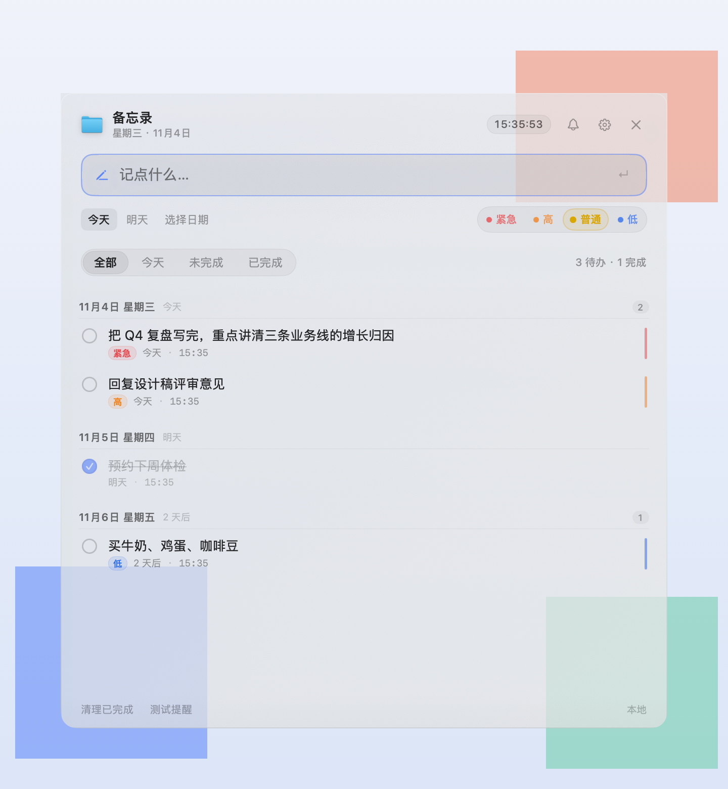
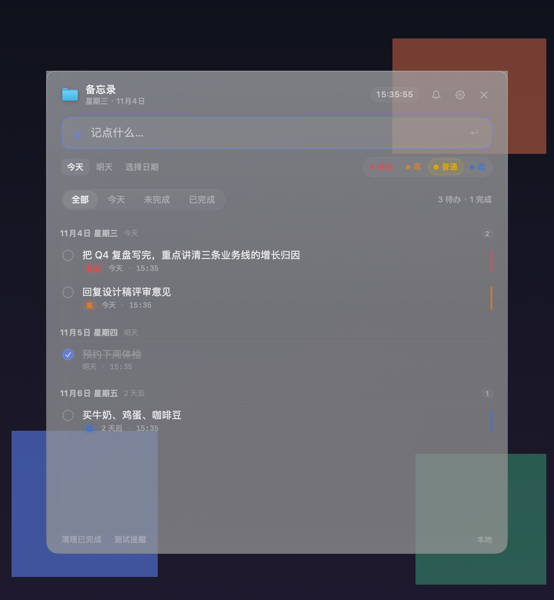
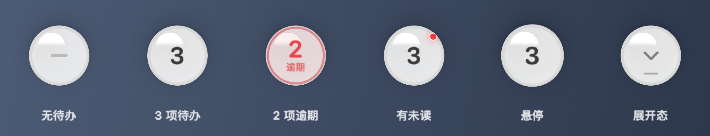

# 本机备忘录 · MemoNative

> 一个常驻 macOS 菜单栏的原生备忘录 App。按 `⌥Space` 就地弹出输入框，回车即存；收起后留下一颗可拖动的悬浮球。

**纯原生** · AppKit + SwiftUI · 无 Xcode、无 WebView、无后台服务 · 数据只在本机

```
⌥Space 召唤 ──▶ 输入 ──▶ 回车保存 ──▶ 收起成悬浮球 ──▶ 点球再展开
```

| | |
|---|---|
| **平台** | macOS 13+ (arm64) |
| **构建** | `swiftc` 直编，只需 Command Line Tools |
| **数据** | `~/Library/Application Support/MemoNative/memos.json` |
| **测试** | 64 项断言，`./scripts/test.sh` |
| **分发** | 无需签名，本地 ad-hoc |

---

## 界面

| 浅色 | 深色 |
|---|---|
|  |  |

悬浮球各状态（无待办 / 待办 / 逾期 / 未读 / 悬停 / 展开）：



设置页：

| 浅色 | 深色 |
|---|---|
|  |  |


## 特性

- **随手召唤**：`⌥Space` 全局快捷键 / 菜单栏图标 / 悬浮球 / `memo://` URL
- **就地输入**：回车即存，带优先级（紧急/高/普通/低）与日期
- **自动分组**：按日期排序，逾期高亮
- **每日提醒**：默认 09:00，系统通知；App 未运行也会弹
- **悬浮球**：折叠态常驻，可拖到屏幕任意位置、记住位置
- **玻璃效果**：面板与悬浮球的通透度可调，设置里一根滑杆实时生效
- **撤销**：删除与「清理已完成」都有 1.5 秒后悔通道
- **数据安全**：文件损坏时自动备份并暂停写入，绝不用空数据覆盖

## 构建与运行

本机只需 Command Line Tools（不需要完整 Xcode）：

```bash
cd memo-native
./scripts/build.sh                 # 编译出 build/MemoNative.app
open build/MemoNative.app          # 运行
```

装到「应用程序」目录（需要在你自己终端里执行，我的沙箱无权写 /Applications）：

```bash
cp -R memo-native/build/MemoNative.app /Applications/
open /Applications/MemoNative.app
```

> 首次启动会自动弹出面板并请求通知权限。**建议允许通知**；若拒绝，提醒会自动降级到 `osascript` 通道，仍然会弹，只是点通知不能回跳 App。

## 随手召唤的四种方式

| 方式 | 操作 | 适用 |
| --- | --- | --- |
| 全局快捷键 | `⌥Space`（Option + 空格） | 任意 App 内，最快 |
| 菜单栏图标 | 单击图标 → 弹面板；右键 → 待办清单 | 鼠标流 |
| URL Scheme | `open memo://toggle` | Raycast / Alfred / 脚本 / 快捷指令 |
| 通知点击 | 点每日提醒 → 打开面板 | 从提醒直接进入 |

面板贴光标弹出，`Esc` 立即收起，不打断当前工作。

### 界面与时间

- **顶部实时时钟**：显示当前系统时间（时:分:秒），每秒刷新，跟随系统时区变化。
- **日期选择**：不再依赖系统日期选择器的弹出层（在非激活面板里常常点不开）。
  改为「今天 / 明天 / 选日期」三个显式选项；选「选日期」时用左右箭头逐日调整，
  右侧同时显示「11月6日 · 3 天后」这样的相对描述。
- **提醒时间可编辑**：设置里的时/分是可直接输入的数字框，超出范围会自动夹取
  （小时 0–23，分钟 0–59），不会写入非法值。
- **记录时间只读**：每条事项下方显示 `记于 HH:mm`，取自系统记录的创建时间，不可编辑。

### 悬浮球

面板收起后，屏幕上留下一颗圆球。它是「随手召唤」的常驻入口，也是折叠态。

```
面板展开 ──收起──▶ 悬浮球（常驻）
   ▲                    │
   └────── 点球 ────────┘
```

| 状态 | 表现 |
|---|---|
| 有待办 | 球里显示待办数量 |
| 有逾期 | 数字变红，外圈浮现一圈红晕 |
| 全部完成 | 显示三个灰点，保持安静 |
| 有未读提醒 | 右上角一个小红点 |
| 悬停 | 放大到 1.05 倍，阴影加深 |

**拖动**：按住球拖到任意位置，松手会自动吸附到最近的屏幕左右边缘。
位置会被记住，重启后回到原处；如果换了显示器导致坐标失效，会自动回到主屏右上角。

**开关**：设置 → 显示悬浮球。

### 玻璃效果怎么调

设置 → 「玻璃效果」一根滑杆，0（几乎不透明）到 1（极透），拖动即时生效，面板和悬浮球一起变。

滑杆调的是 `NSVisualEffectView` 的 `alphaValue`，但要换算：**alpha 越小越透**，所以内部做了一次反转（`GlassAppearance`）。不直接暴露 alpha，是因为反向刻度用起来很别扭——往右拖本意是"更透"，参数却是在变小。

几个实现上的坑，都踩过了：

- **窗口必须透明**。`NSPanel` 默认 `isOpaque = true`，会先铺一层不透明底，`behindWindow` 材质只采得到那块底，玻璃效果等于不存在。
- **透明窗口要有系统阴影**。`isOpaque = false` 配 `hasShadow = false`，窗口会直接「消失」在屏幕上。
- **玻璃要更透，靠减少填充而不是增加填充**。试过往上叠 10% 白，透光率反而从 0.378 掉到 0.343。
- **悬浮球需要一层实心底衬**。球是漂在桌面上的孤立圆形，整体透掉之后只剩一圈高光，等于从屏幕上消失。所以低强度时底衬接近不透明，高强度时才让位给玻璃。

强度映射的取值不是拍脑袋，是量出来的。下面表格是实测的球心 alpha（越低越透）：

| 强度 | 0.0 | 0.3 | 0.55 | 0.8 | 1.0 |
|---|---|---|---|---|---|
| 球心 alpha | 1.000 | 0.976 | 0.910 | 0.780 | 0.596 |

两端相差 40%，拖动时肉眼能明显看出变化。中间调过一次：最初底衬权重给太大，实测 alpha 只从 1.00 走到 0.80，滑杆几乎无效，后来把底衬压到高强度时归零才正常。

### 为什么球和面板不同时出现

球常驻 `floating` 层级，而面板失焦后会降到 `normal`。两者若同时可见，球会**永远压在面板上面**，
连内容都点不到。所以做成互斥：展开时球隐去，收起时球浮现——这也正是「折叠」该有的语义。

球的隐藏用 `alphaValue = 0` 而不是 `orderOut`：
后者会让窗口在下次 `orderFront` 时丢掉尺寸（变 0×0），球就再也画不出来了。

## 面板与窗口的层级联动

面板**不是永久置顶**的。它会跟着焦点走：

| 时机 | 层级 | 效果 |
| --- | --- | --- |
| 刚召唤、正在输入 | 置顶（`floating`） | 浮在其他窗口之上，方便连续记录 |
| 点击别的窗口 / 切到别的 App | 降到普通层（`normal`） | 被目标窗口自然盖住，不挡路 |
| 切回本 App | 恢复置顶 | 立刻继续可输入 |

在「设置」里可以改这个行为：

- **退到下一层**（默认）— 切走时沉下去但仍留在屏幕上
- **失去焦点时收起** — 切走时直接隐藏，最干净
- **保持置顶** — 永远浮在最上面，直到手动关闭

另外，刚召唤后的 0.7 秒是保护期：系统在启动或切换 App 的瞬间会连发失焦通知，
这段时间内的失焦不算「你点了别处」，面板不会因此被莫名收掉。

### URL Scheme 全清单

```bash
open memo://toggle                                   # 显示/隐藏面板
open "memo://add?title=买牛奶"                        # 直接新增（默认今天/普通）
open "memo://add?title=交报表&priority=high&due=2026-11-06"
open memo://remind                                   # 立即推送一次提醒
open "memo://delete?title=关键词"                     # 按标题关键词删除
```

`priority` 取值：`urgent` / `high` / `normal` / `low`。

## 每天 09:00 提醒怎么工作

三层保障，避免漏提醒：

1. **系统级重复通知**：`UNCalendarNotificationTrigger` 排定每天 09:00，App 没运行也会弹。
2. **App 内定时器**：运行中到点发一条带真实摘要的通知（列出未完成事项，最多 6 条）。
3. **唤醒补偿**：Mac 睡眠唤醒、修改系统时间/时区后自动重新对齐；若今天已过点且还没提醒过，立即补发一次。

通知成功与否都会写一条站内记录，面板右上角 🔔 显示未读数。

改提醒时间：面板右上角 ⚙️ → 每日提醒时间。

## 功能

- 单输入框录入，`Enter` 保存并清空，焦点留在输入框可连续录入
- 四级优先级：🔴 紧急 / 🟠 高 / 🟡 普通 / 🔵 低，点击或 `⌘1`~`⌘4`
- 按日期自动分组排序：日期 → 未完成 → 优先级 → 创建时间
- 组头显示「今天 / 明天 / 3 天后 / 逾期 N 天」，逾期红色高亮
- 双击标题就地改名；点圆圈完成；点优先级徽标循环切换
- 筛选：全部 / 今天 / 未完成 / 已完成；一键清理已完成
- 右键菜单：完成、改名、直达任一优先级、删除
- 深色模式自动适配，面板跟随光标位置且不会跑出屏幕

## 数据

- 位置：`~/Library/Application Support/MemoNative/memos.json`
- 格式与网页版一致（`items` / `reminders` / `lastReminderDate`），可直接迁移
- 写入采用临时文件 + 原子替换，避免写坏
- 改文件前请先退出 App（运行中会以内存为准覆盖）

## iPhone 快捷指令联动（无需 iOS App）

在 iPhone「快捷指令」里加一个「打开 URL」动作，填：

```
memo://add?title=买牛奶&priority=high
```

配合「轻点背面」「Siri」「锁屏小组件」，在手机上一点就把事记到 Mac 上。
`due` 不传默认今天；需要在手机上选日期时，用「要求输入」变量拼进 URL 即可。

## 目录结构

```
memo-native/
├── Sources/MemoNative/
│   ├── App.swift              入口、菜单栏、URL scheme
│   ├── Models.swift           数据模型与存储（原子写 + 损坏保护）
│   ├── ContentView.swift      主界面
│   ├── PanelController.swift  浮动面板、焦点联动、全局快捷键
│   ├── FloatingOrb.swift      悬浮球（折叠态）
│   ├── OrbMetrics.swift       悬浮球几何常量（可测）
│   ├── SettingsView.swift     设置界面
│   ├── SettingsSnapshot.swift 设置回滚快照
│   ├── SettingsWindow.swift   独立设置窗口
│   ├── ReminderService.swift  到点提醒调度
│   ├── ReminderCenter.swift   系统通知封装
│   ├── NotifyBridge.swift     无签名时的 osascript 降级通道
│   ├── LaunchAtLogin.swift    登录启动
│   ├── UILogic.swift          纯函数（时间/日期，可测）
│   └── Digest.swift           提醒摘要生成
├── docs/                      界面预览图
├── Tests/                     64 项断言
├── Resources/                 Info.plist、AppIcon.icns、图标源文件
└── scripts/
    ├── build.sh               编译出 build/MemoNative.app
    ├── test.sh                跑单元测试
    ├── install.sh             安装到「应用程序」
    └── make_icon.py           重新生成 App 图标
```


## 测试

```bash
./scripts/test.sh
```

64 项断言，覆盖：排序（日期→完成态→优先级）、分组、日期标签、摘要截断、JSON 兼容、增删改、完成态、撤销删除（含幂等）、持久化重载、数据损坏保护、提醒记录与上限、已读标记、时间字段解析与夹取、悬浮球几何。

测试只链接纯逻辑层（Models / UILogic / OrbMetrics），不起 GUI，因此跑得很快。


## 已知限制

- 本机没有 Apple 开发者签名证书，App 是 ad-hoc 签名，因此 **UNUserNotificationCenter 授权被系统拒绝**，实际走 `osascript` 通知通道（效果相同，点通知不能回跳）。装上正式证书后会自动使用原生通知。
- 全局快捷键 `⌥Space` 通过 Carbon 注册，**合成按键事件无法触发**（HID 层限制），需要你实际按键确认；注册状态在日志里可见。
- 未做 App Store 分发与公证；仅本机使用。
- 若你希望「iPhone 上也有原生 App + iCloud 同步」，需要 Xcode 与 iOS SDK（本机未安装），可另行搭建。


## 交互与数据安全

### 设置页

设置是一个**独立窗口**，不是面板上的 sheet。

关闭方式有四种：顶部 **×**、底部 **取消 / 完成**、按 **Esc**、点窗口关闭钮。
其中 **取消** 会回滚本次改动（打开设置时的快照），不是「关掉就生效」。

底部还有 **恢复默认**，一键重置提醒时间与各项开关。

> **为什么不用 sheet？**
> 面板是 `.nonactivatingPanel`，它的 sheet 会继承同样的 styleMask，
> 结果就是窗口画出来了却**永远成不了 key window**——按钮点不动、Esc 不响应、
> 输入框收不到键盘。用独立窗口承载才能正常交互。


### 撤销

删除单条、或「清理已完成」批量清理后，底部提示条会出现 **撤销**，1.5 秒内可反悔。

> 清理已完成是批量销毁操作，之前误点就没了，现在有后悔通道。

### 数据损坏保护

如果 `memos.json` 损坏到无法解析：

1. 自动备份为 `memos-broken-<时间戳>.json`
2. **暂停写入** —— 否则内存里的空数组会把坏文件覆盖成空，原始数据永久丢失
3. 界面底部显示错误提示

宁可这一次改动丢失，也不覆盖原始数据。

### 菜单栏图标开关

「在菜单栏显示图标」是真实生效的：关掉会立即从菜单栏移除，重启后也不会再出现。


### 启动不自动收起

面板在启动后可能被系统补发的「失焦」通知误判成「用户点了别处」而自动收起。

现在的处理：
1. 启动保护期 1.6 秒，这段时间内的失焦通知一律忽略
2. `NSApp.activate` 在 `makeKeyAndOrderFront` 之前完成
3. 下一轮 runloop 再确认一次 key window

实测启动后 10 秒内面板稳定保持。

